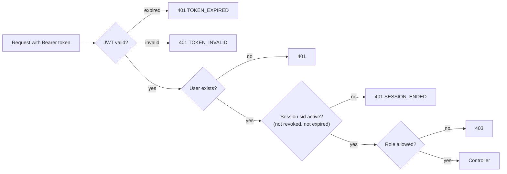
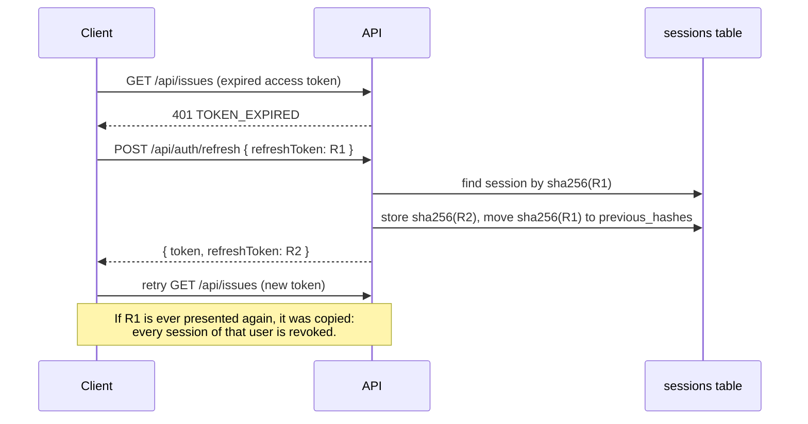
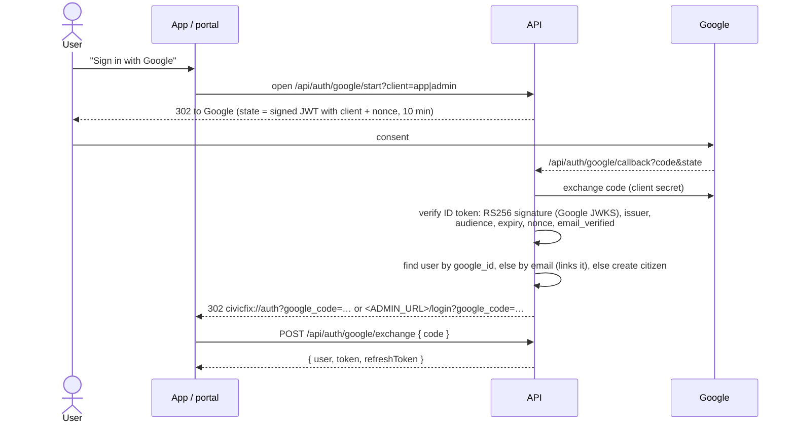

# Authentication and sessions

How people sign in, how the API recognises them on every request, and how sessions end. Endpoint details are in the [API reference](../api/reference.md#3-authentication-endpoints); setting up email, SMS and Google is in [Sign-in providers](../deployment/sign-in-providers.md).

## Roles

| Role | How the account is created | Can use |
|---|---|---|
| `citizen` | Self-service: email + password, phone + SMS code, or Google (app) | Android app: report issues, see own reports |
| `staff` | An admin adds them (portal → Staff) or `create-staff` script | Admin portal: view and update issues, see reporters |
| `admin` | `create-staff --role admin` or promoted by another admin | Everything staff can, plus delete issues and manage accounts |

Public sign-up can never create `staff` or `admin` accounts. Role checks read the role from the database on every request, so promotions and demotions apply immediately.

## Tokens and sessions

Every successful sign-in, by any method, calls `startSession` (`backend/src/services/sessions.js`) and returns:

| Token | Format | Lifetime | Stored by the client in | Sent |
|---|---|---|---|---|
| Access token | JWT, HS256, claims `userId`, `role`, `sid` | `ACCESS_TOKEN_TTL` (15 min) | Memory + `localStorage` (portal) / AsyncStorage (app) | `Authorization: Bearer …` on every request |
| Refresh token | 32 random bytes, base64url | `REFRESH_TOKEN_DAYS` (30 days) | Same | Only to `POST /api/auth/refresh` and `/logout` |

The server keeps one row per session in `sessions`, with the **SHA-256 hash** of the current refresh token (never the token itself), the sign-in method, user agent, IP, expiry and revocation time.

### Request authentication

Public issue endpoints use the same check but treat a missing or bad token as anonymous instead of failing.

### Renewal and rotation

Both clients renew at most once at a time (a single in-flight refresh shared by concurrent requests) and retry the original request once. If renewal fails, the user is sent to the sign-in screen.

### Ending sessions

| Event | Effect |
|---|---|
| Sign out (`/logout`) | That session is revoked |
| Sign out everywhere (`/logout-all`, app Profile screen) | All sessions of the account revoked |
| Change password | All *other* sessions revoked |
| Reset password by email code | All sessions revoked |
| Admin resets someone's password | All of that person's sessions revoked |
| Refresh token reuse detected | All sessions revoked |
| 30 days without use | Session expires |

Because every request checks the session, a revoked session stops working immediately, not when its access token expires.

## Sign-in methods

### Email and password

- Passwords: bcrypt (cost 10), minimum 8 characters. Emails are stored and compared in lower case.
- Wrong email and wrong password give the same `401` message, so accounts cannot be discovered by trying emails.
- **Lockout:** five wrong passwords in a row lock the account for 15 minutes (`429 ACCOUNT_LOCKED`). A successful sign-in resets the counter.
- Staff accounts created by an admin get a random one-time password shown once.

### One-time codes

Used for password reset (email), phone sign-in (SMS) and the Google hand-over. Implemented in `backend/src/services/otp.js`, stored in `otp_codes`:

| Purpose | Code | Valid for | Limits |
|---|---|---|---|
| `password_reset` | 6 digits, by email | 15 min | 5 wrong tries per code; 60 s between requests; 5 per hour per address |
| `phone_login` | 6 digits, by SMS | 10 min | Same |
| `google_login` | random, in a redirect URL | 2 min | One use |

Codes are stored as SHA-256 hashes, are single-use, and issuing a new code invalidates older unused ones for the same target. "Forgot password" always answers with the same message whether or not the email exists.

### Phone number

1. `POST /otp/request { phone }` (E.164, e.g. `+919876543210`) sends a code through SNS.
2. `POST /otp/verify { phone, code, name? }` signs in. For a number with no account the API first answers `400 NAME_REQUIRED` *without* using up the code; the app asks for a name and calls again, creating a citizen account (`201`).

Phone-only accounts have no email or password; they can set a password later from Profile.

### Google

- The Google tokens never reach the client; the client only gets a 2-minute, single-use hand-over code.
- Through the portal (`client=admin`), only accounts that already exist with role `staff` or `admin` may sign in; others get `error=not_staff`. New Google users from the app become citizens.
- The redirect URI registered with Google must be `<PUBLIC_API_URL or API host>/api/auth/google/callback`.

## Client storage

| Client | Where tokens live | Notes |
|---|---|---|
| Admin portal | `localStorage` (`admin_token`, `admin_refresh`, `admin_user`) | Short access-token lifetime and server-side revocation limit the impact of theft; an HttpOnly-cookie session would remove script access entirely (see [threat model](../security/threat-model.md)) |
| Android app | AsyncStorage (`@civicfix/token`, `@civicfix/refresh`, `@civicfix/user`) | App-private storage; not encrypted at rest beyond Android's file-based encryption |

## Configuration

`JWT_SECRET` (32+ characters, required), `ACCESS_TOKEN_TTL`, `REFRESH_TOKEN_DAYS`, `AUTH_RATE_LIMIT_MAX`, and the provider settings. See [Configuration](../reference/configuration.md).

Rotating `JWT_SECRET` invalidates every access token and Google `state` immediately; refresh tokens still work (they are not JWTs), so clients renew silently.
