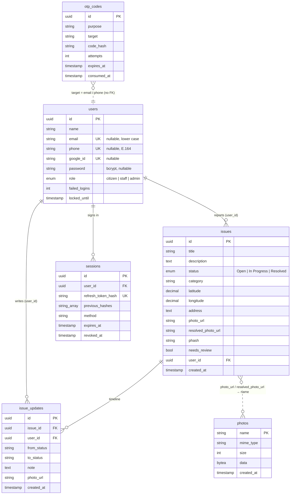

# Data model

All data lives in one PostgreSQL database (version 17 on AWS). Models are defined with Sequelize in [`backend/src/models/`](../../backend/src/models); column names are `snake_case`, primary keys are UUIDs unless noted.

## Tables

### `users`

| Column | Type | Notes |
|---|---|---|
| `id` | UUID | |
| `name` | string | Required |
| `email` | string, unique, nullable | Stored in lower case. Null for phone-only accounts |
| `phone` | string(20), unique, nullable | E.164, e.g. `+919876543210` |
| `google_id` | string(64), unique, nullable | Google's `sub`; set on first Google sign-in |
| `password` | string, nullable | bcrypt hash. Null for phone/Google accounts until they set one |
| `role` | enum `citizen`, `staff`, `admin` | Default `citizen` |
| `failed_logins` | integer | Consecutive wrong passwords; reset on success |
| `locked_until` | timestamp, nullable | Set for 15 minutes after five wrong passwords |
| `created_at`, `updated_at` | timestamp | |

Every account has at least one way to sign in: an email with a password, a phone number, or a Google ID.

### `issues`

| Column | Type | Notes |
|---|---|---|
| `id` | UUID | |
| `title`, `description` | string, text | Required |
| `status` | enum `Open`, `In Progress`, `Resolved` | Always `Open` on creation |
| `category` | string(30) | One of the ids below; default `other` |
| `latitude`, `longitude` | decimal(9,6) | Device location at report time; validated ranges |
| `address` | text, nullable | Reverse-geocoded label, or `Location (lat, lon)` |
| `photo_url` | string, nullable | `…/uploads/<photos.name>` |
| `resolved_photo_url` | string, nullable | Photo staff added when resolving |
| `phash` | string, nullable | 64-bit perceptual hash (hex) for duplicate detection |
| `needs_review` | boolean | Set when evidence is uncertain (see [Evidence validation](evidence-validation.md)) |
| `user_id` | UUID FK → `users`, nullable | Reporter. `ON DELETE SET NULL` keeps the issue if the account is removed |
| `created_at` | timestamp | No `updated_at`; changes are recorded in `issue_updates` |

Categories (`backend/src/constants/categories.js`, served at `GET /api/issues/categories`): `pothole`, `road_damage`, `streetlight`, `garbage`, `water_supply`, `drainage`, `traffic_signal`, `fallen_tree`, `other`.

### `issue_updates`

The public timeline of an issue: the report itself, status changes, notes and resolution photos.

| Column | Type | Notes |
|---|---|---|
| `issue_id` | UUID FK → `issues` | `ON DELETE CASCADE` |
| `user_id` | UUID FK → `users`, nullable | Author; `SET NULL` on account removal |
| `from_status`, `to_status` | string, nullable | Both set for a status change |
| `note` | text, nullable | Up to 1,000 characters |
| `photo_url` | string, nullable | Resolution photo added with this update |
| `created_at` | timestamp | |

### `photos`

| Column | Type | Notes |
|---|---|---|
| `name` | string(100), primary key | Generated upload name, e.g. `issue-1732150000000-<24 hex>.jpg` |
| `mime_type` | string(50) | `image/jpeg`, `image/png`, `image/gif` or `image/webp` |
| `size` | integer | Bytes (max 10 MB) |
| `data` | bytea | The image |

Photos are linked to issues by URL, not by foreign key: `issues.photo_url`, `issues.resolved_photo_url` and `issue_updates.photo_url` end in `/uploads/<name>`. Deleting an issue deletes its photos. `npm run prune-uploads` finds photos no row references.

### `sessions`

One row per signed-in device. See [Authentication](authentication.md#tokens-and-sessions).

| Column | Notes |
|---|---|
| `user_id` | FK → `users`, `ON DELETE CASCADE` |
| `refresh_token_hash` | SHA-256 of the current refresh token, unique |
| `previous_hashes` | Hashes of rotated-away tokens, for reuse detection |
| `method` | `password`, `phone` or `google` |
| `user_agent`, `ip` | For display and investigation |
| `expires_at`, `last_used_at`, `revoked_at` | A session is active when not revoked and not expired |

### `otp_codes`

| Column | Notes |
|---|---|
| `purpose` | `password_reset`, `phone_login`, `google_login` |
| `target` | Email or phone number; user id for `google_login` |
| `code_hash` | SHA-256 of the code |
| `attempts` | Wrong guesses (max 5) |
| `expires_at`, `consumed_at` | Single use |

Indexed on `(purpose, target)`. Old rows are harmless; they can be deleted periodically (`DELETE FROM otp_codes WHERE expires_at < now() - interval '1 day'`).

## Schema changes

There is no separate migration tool. On start-up (`backend/src/config/schema.js`, when not in production or when `DB_SYNC=true`) the API:

1. Creates missing tables (`sequelize.sync()`, which never alters existing tables).
2. Adds any column a model has but the table lacks, using the model's default for existing rows.
3. Drops `NOT NULL` on `users.email` and `users.password` (made optional for phone/Google accounts).

It never drops, renames or narrows columns. Rules for contributors:

- Only **add** columns, and give new non-null columns a default.
- To rename or remove a column, add the new one, ship code that uses it, migrate data with a one-off script, and only then drop the old one by hand in a later release.
- Add an integration test in `backend/test/integration/schema.test.js` for upgrades from an older schema.

## Data retention

| Data | Kept | Removed by |
|---|---|---|
| Issues, timeline, photos | Until an admin deletes the issue | `DELETE /api/issues/:id` (cascades to updates and photos) |
| Accounts | Until removed by an operator | Manual (see [Privacy](../security/privacy.md)) |
| Sessions | 30 days after last use, then inactive | Rows can be purged when `expires_at` has passed |
| One-time codes | 2–15 minutes valid | Rows can be purged after expiry |
| Backups (AWS) | `DB_BACKUP_DAYS` (default 7) + final snapshot on stack deletion | RDS |
