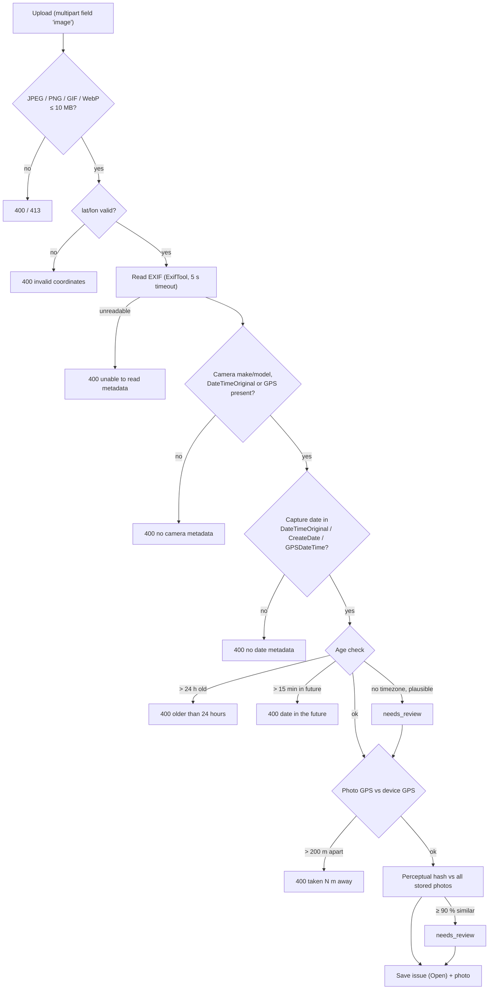

# Evidence validation

A report is only useful if its photo was really taken at that place, recently. When a citizen submits a report with a photo, the API checks the photo's embedded metadata before saving anything. Code: `createIssue` in [`apps/api/src/controllers/issueController.js`](../../apps/api/src/controllers/issueController.js), date rules in [`apps/api/src/utils/photoDate.js`](../../apps/api/src/utils/photoDate.js).

## Pipeline

Every rejection returns `400` with a `message` the app shows to the citizen, and the uploaded file is deleted from disk and from the `photos` table (`discardFileOnFailure` in `apps/api/src/middleware/upload.js`). Rejected photos are never stored or served.

## Rules

### 1. File type and size

Only `image/jpeg`, `image/png`, `image/gif` and `image/webp`, one file, at most 10 MB (`413` above that). Files get a server-generated name (`issue-<timestamp>-<random>.<ext>`); the client's file name is never used.

### 2. Metadata must exist

The photo must carry at least one of: camera make/model, `DateTimeOriginal`, or any GPS tag. Screenshots, images downloaded from the web and most edited images have none and are rejected.

### 3. Capture date: at most 24 hours old

Only dates embedded in the image count, in this order: `DateTimeOriginal`, `CreateDate`, `GPSDateTime`. Filesystem dates (`FileModifyDate` and similar) are ignored: they describe the copy the server just saved and would make every photo look new.

| Case | Result |
|---|---|
| Date with timezone, 0–24 h old | Accepted |
| More than 24 h old | Rejected |
| More than 15 minutes in the future (fast phone clocks are tolerated) | Rejected |
| Date without timezone | The real moment could be 14 h earlier to 12 h later. Rejected only if it is too old (or in the future) under **every** timezone; otherwise accepted and marked `needs_review` |

### 4. Location: within 200 metres

The photo's GPS position (from `GPSLatitude`/`GPSLongitude` with N/S/E/W references, or `GPSPosition`) is compared with the location the device reported, using the geodesic distance (`geolib`). More than 200 m apart is rejected with both positions in the message.

### 5. Duplicates: perceptual hash

A 64-bit perceptual hash (pHash, `image-hash`) of the photo is compared with every stored hash by Hamming distance. At 90 % similarity or more the report is still saved but marked `needs_review`, so staff can check whether it repeats an existing report. A failure to compute the hash never blocks a report.

### 6. Reverse geocoding (not a check)

The coordinates are turned into an address with OpenStreetMap Nominatim (cached for 24 hours, with retries). If it fails or `GEOCODING_ENABLED=false`, the address is `Location (lat, lon)`. It never blocks a report.

## `needs_review`

An issue is flagged for staff review when:

- the capture date had no timezone, so its age could not be confirmed exactly;
- its photo is at least 90 % similar to an existing photo;
- the report was submitted with a `photo_url` instead of an uploaded file (no metadata to check).

Staff find these with the **Needs review** filter in the portal (`GET /api/issues?needs_review=true`), and the overview counts open ones.

## Known limitations

These are deliberate trade-offs or open items. They are also listed in the [threat model](../security/threat-model.md).

| Limitation | Why | Mitigation |
|---|---|---|
| EXIF can be edited by a determined user | Metadata is not cryptographically signed | Staff review; duplicate detection; reports are tied to an account |
| Photos **without any GPS tags** pass the location check (device location is used instead) | Many gallery photos and some cameras omit GPS | Date and metadata checks still apply. Flagging these as `needs_review` is a possible future change |
| GPS tags that exist but cannot be decoded are treated like "no GPS" | Some phones write formats ExifTool returns as binary | Same as above |
| The API accepts a report with no photo at all | Backward compatibility with older clients | The Android app requires a photo before it submits |
| Duplicate search is linear in the number of issues | Simplicity | Fine for tens of thousands of issues ([scaling](overview.md#scaling-and-performance)) |

## Testing

`apps/api/test/integration/evidence.test.js` covers each rejection with real images (`test/fixtures/`, rewritten with ExifTool per test), stripped dates, future dates, distance, rejected-file clean-up and duplicates. `apps/api/test/unit/photoDate.test.js` covers timezone handling. The Android end-to-end flow `03-report-issue` submits a real camera-stamped photo through the whole pipeline.
