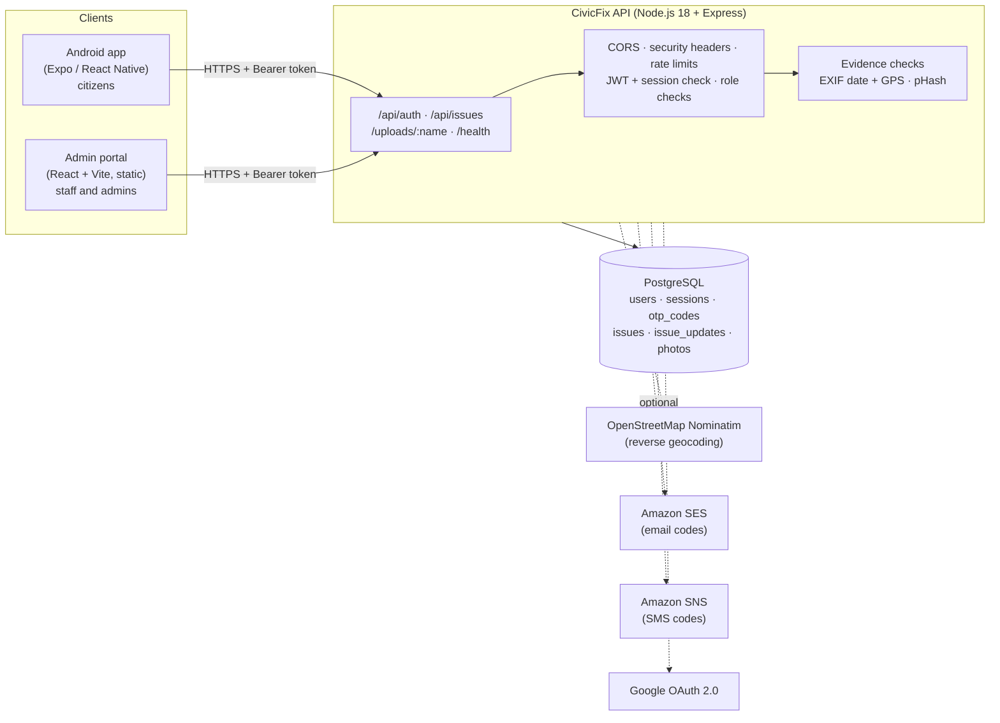
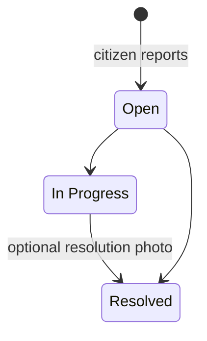
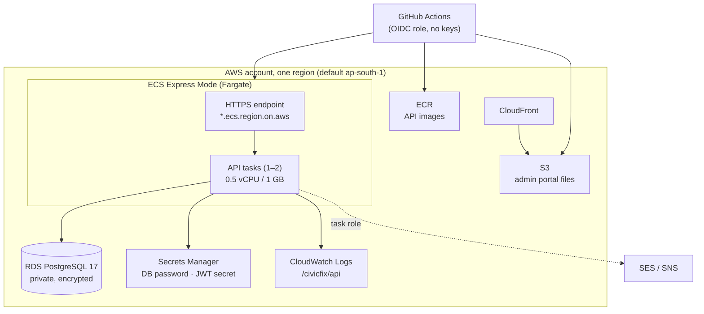

# Architecture overview

CivicFix is three applications around one API and one PostgreSQL database.



## Components

| Component | Location | Responsibility |
|---|---|---|
| API | [`apps/api/`](../../apps/api/README.md) | Accounts and sessions, issue lifecycle, evidence checks, photo storage and serving, statistics |
| Admin portal | [`apps/admin/`](../../apps/admin/README.md) | Staff triage issues, change status/category, add notes and resolution photos; admins manage staff |
| Android app | [`apps/mobile/`](../../apps/mobile/README.md) | Citizens sign up, report issues with a photo and location, follow their reports |
| Infrastructure | [`infra/aws/`](../../infra/aws/README.md) | CloudFormation templates for AWS |
| End-to-end tests | [`e2e/`](../../e2e/README.md) | Playwright (portal) and Maestro (Android) suites |

### API internals

```text
apps/api/
├── server.js              start-up: config checks, DB connect, schema sync, listen
└── src/
    ├── app.js             Express app: middleware order, routes, /uploads, /health
    ├── config/            db.js (Sequelize + TLS), schema.js (additive schema sync)
    ├── constants/         issue categories
    ├── routes/            URL → validation → controller (express-validator)
    ├── controllers/       authController, issueController (request handling)
    ├── middleware/        auth, rate limiter, upload (multer), error handler
    ├── models/            Sequelize models and associations
    ├── services/          sessions, OTP codes, notify (SES/SNS), Google, AWS SigV4
    └── utils/             EXIF/photo dates, pHash, geocoding, photo store, serialisers
```

Request pipeline, in order (`src/app.js`):

1. CORS allow-list (`CORS_ORIGINS`; requests without an `Origin`, such as the Android app, are allowed).
2. JSON / form body parsing, 1 MB limit.
3. Security headers (`nosniff`, `X-Frame-Options: DENY`, `no-referrer`, HSTS in production).
4. Global rate limit: `RATE_LIMIT_MAX` requests per minute per IP (default 300). Sign-in routes have a stricter limiter (`AUTH_RATE_LIMIT_MAX`, default 30).
5. Routes. Protected routes verify the access token, load the user and check the session is still active, then check the role.
6. Error handler: JSON `{ message }`; 5xx details hidden in production.

## Key flows

### Reporting an issue

```mermaid
sequenceDiagram
  actor C as Citizen (app)
  participant A as API
  participant D as PostgreSQL
  participant N as Nominatim

  C->>A: POST /api/issues (multipart: photo, title, category, lat, lon)
  A->>A: multer saves photo (≤10 MB, JPEG/PNG/GIF/WebP)
  A->>A: read EXIF: camera data, capture date ≤24 h old and not in the future,<br/>photo GPS within 200 m of device GPS
  alt evidence rejected
    A-->>C: 400 with a reason; the photo is deleted
  end
  A->>N: reverse geocode (cached 24 h; optional)
  A->>A: pHash; ≥90 % similar to an existing photo → needs_review
  A->>D: insert issue (status Open) + photo bytes
  A-->>C: 201 issue
```

Rules and edge cases: [Evidence validation](evidence-validation.md).

### Resolving an issue

Staff open the issue in the portal and `PUT /api/issues/:id` with a new status, category, a note and optionally a resolution photo. Each change is recorded as an `issue_updates` row, which the citizen sees as a timeline in **My Reports**.



New reports always start `Open`. Staff and admins may set any of the three statuses at any time (including reopening); a photo uploaded while the issue is, or becomes, `Resolved` is stored as the resolution photo.

### Signing in

Access tokens are short-lived JWTs tied to a server-side session; refresh tokens rotate on every use. Password, phone + SMS code and Google sign-in all end in the same session. Details: [Authentication](authentication.md).

## Data storage

All state is in PostgreSQL, including photo bytes (`photos` table), so the API containers are stateless and can be replaced at any time. A local `uploads/` folder is only a cache. Schema: [Data model](data-model.md).

## Deployment topology (AWS)



Full detail: [Deploy on AWS](../deployment/aws.md) and [`infra/aws/`](../../infra/aws/README.md).

## Scaling and performance

| Concern | Current behaviour | When it matters |
|---|---|---|
| API instances | 1–2 Fargate tasks, stateless | Raise `MaxTasks` in `infra/aws/api.yml` |
| Rate limits | In memory, per task | With several tasks each enforces its own limit; move to a shared store (e.g. Redis) for exact limits |
| Geocoding cache | In memory, 24 h, 1,000 entries, per task | Nominatim's usage policy allows ~1 request/s; use a commercial geocoder at scale |
| Duplicate detection | Compares a new photo's pHash with every stored hash | Linear in the number of issues; fine for tens of thousands, then index or bucket hashes |
| Photo storage | Bytes in PostgreSQL, served by the API with a 1-day cache header | Move to S3 + CloudFront when the database grows past a few tens of GB ([ADR 0003](decisions/0003-store-photos-in-postgresql.md)) |
| Database | `db.t4g.micro`, single AZ | Set `DB_INSTANCE_CLASS`; enable Multi-AZ for higher availability |

## Architecture decisions

The reasons behind the main choices are recorded as [architecture decision records](decisions/README.md).
