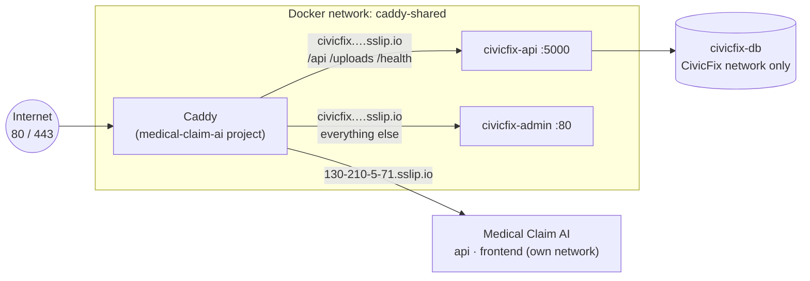

# Deploy on a shared Oracle Cloud server (Docker Compose)

Runs CivicFix on a server that already hosts [Medical Claim AI](https://github.com/santhosh12133/medical-claim-ai), sharing its Caddy web server for free HTTPS. CivicFix publishes no ports of its own.



| Piece | Where |
|---|---|
| Code, `.env` (mode 600, root) | `/opt/civicfix` |
| Containers | Compose project `civicfix`: `civicfix-db`, `civicfix-api`, `civicfix-admin` |
| Caddy site file | `/opt/caddy-sites/civicfix.caddy` (written by the script) |
| Database (incl. photos) | Docker volume `civicfix_civicfix_db` |
| Backups | `/var/backups/civicfix`, daily 03:10, 7 days |
| Admin password | `/root/civicfix-credentials.txt` (root only) |
| Address | `https://civicfix.<ip-with-dashes>.sslip.io` (free, no DNS setup) |

## Requirements

- Medical Claim AI updated to a version whose `deploy/setup-server.sh` creates the `caddy-shared` network and `/opt/caddy-sites` (re-run it once).
- About 700 MB of free memory (the script checks). CivicFix uses roughly 0.3–0.5 GB; containers are capped at 512 MB (API), 512 MB (database), 64 MB (portal).
- x86_64 or arm64 (tested on both in CI, `.github/workflows/server-deploy.yml`).

## Install or update

```bash
curl -fsSL https://raw.githubusercontent.com/santhosh12133/CivicGuardAI/main/deploy/setup-server.sh -o /tmp/civicfix-setup.sh
sudo bash /tmp/civicfix-setup.sh --admin-email you@example.com
```

The script checks memory and the shared Caddy, clones or updates `/opt/civicfix`, creates secrets on the first run, builds and starts the stack, writes the site file, validates it with Caddy and reloads (keeping the old configuration if anything is wrong), creates the admin account once, installs the backup job, and finishes with a health check of both sites. Re-running it updates the code and keeps secrets, data and accounts. `--help` lists all options.

Then read the admin password with `sudo cat /root/civicfix-credentials.txt`, and in the Android app set the server address (Login → Server) to the address the script printed. To build an APK with that address built in, run **Actions → Android APK** with `api_url` set to it.

## Day-to-day

```bash
cd /opt/civicfix
C="sudo docker compose -f docker-compose.yml -f deploy/docker-compose.prod.yml"
$C ps                 # status
$C logs -f civicfix-api
sudo deploy/backup.sh # backup now
```

Optional settings (for example `GOOGLE_CLIENT_ID` / `GOOGLE_CLIENT_SECRET`, with redirect URI `https://<address>/api/auth/google/callback`) go in `/opt/civicfix/.env` (`sudo nano`); re-run the script to apply them.

## Moving to another server (e.g. Oracle Ampere A1)

1. On the old server: `sudo /opt/civicfix/deploy/backup.sh` and copy the newest `/var/backups/civicfix/db-*.dump` off the server.
2. On the new server: set up Medical Claim AI, then run this script (with `--public-ip` if needed). The address changes with the IP.
3. Restore: `cd /opt/civicfix && sudo docker compose -f docker-compose.yml -f deploy/docker-compose.prod.yml exec -T civicfix-db pg_restore -U civicfix -d civicfix --clean --if-exists < db-<stamp>.dump`
4. Point the Android app at the new address (or build a new APK).

## Removing CivicFix

Leaves Medical Claim AI untouched:

```bash
sudo rm /opt/caddy-sites/civicfix.caddy
C=$(sudo docker ps -q --filter label=com.docker.compose.project=medical-claim-ai --filter label=com.docker.compose.service=caddy)
sudo docker exec "$C" caddy reload --config /etc/caddy/Caddyfile --adapter caddyfile
cd /opt/civicfix && sudo docker compose -f docker-compose.yml -f deploy/docker-compose.prod.yml down   # add -v to delete the data
sudo rm /etc/cron.d/civicfix
```
