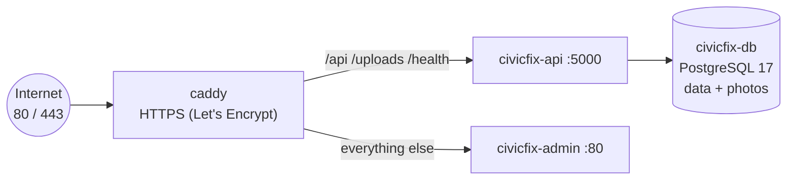

# Deploy on Oracle Cloud (Docker Compose, free HTTPS)

Runs CivicFix — PostgreSQL, the API, the admin portal and Caddy for automatic HTTPS — on one Oracle Cloud VM with Docker Compose. The address is free and needs no DNS: `https://civicfix.<ip-with-dashes>.sslip.io`.



Only Caddy is reachable from outside; the other containers publish no ports.

| Piece | Where on the server |
|---|---|
| Code and `.env` (secrets, mode 600, root only) | `/opt/civicfix` |
| Containers | Compose project `civicfix`: `caddy`, `civicfix-api`, `civicfix-admin`, `civicfix-db` |
| Database (including photos) | Docker volume `civicfix_civicfix_db` |
| Backups | `/var/backups/civicfix` (daily 03:10, 7 days) |
| Admin password | `/root/civicfix-credentials.txt` (root only) |
| Install log (first boot) | `/var/log/civicfix-setup.log` |

## Server size

Everything runs on x86_64 and arm64 (both tested in CI, `.github/workflows/server-deploy.yml`). Measured at idle: about 100 MB for all containers.

| Option | Cost | Notes |
|---|---|---|
| **Ampere A1, 1 OCPU / 6 GB (arm64)** | Always Free | Recommended. Free A1 capacity is often sold out; the create script can keep retrying |
| AMD E2.1.Micro, 1 GB | Always Free | Works with the 4 GB swap the script adds; the first build is slow (about 20–30 minutes) |
| AMD E5.Flex, 1 OCPU / 4 GB | Trial credits | Usually available; reclaimed when the 30-day trial ends |

## Create the server from Oracle Cloud Shell

Open the Oracle console, click **>_** (Cloud Shell) at the top, then:

```bash
curl -fsSL https://raw.githubusercontent.com/santhosh12133/CivicGuardAI/main/deploy/oracle-cloudshell-create.sh -o civicfix-create.sh
ADMIN_EMAIL='you@example.com' bash civicfix-create.sh
```

It creates a network `civicfix-vcn` with ports 22/80/443 open, an RSA SSH key `~/.ssh/civicfix` (Cloud Shell runs in FIPS mode, which refuses other key types) and the VM `civicfix`, which installs CivicFix on first boot. It prints the address and the commands to follow the installation and read the admin password. Options (environment variables): `SHAPE=a1|micro`, `RETRY_MINUTES=360`, `USE_TRIAL_CREDITS=1`. Re-running it reuses what exists.

## Or install on a VM you already have

SSH in, then:

```bash
curl -fsSL https://raw.githubusercontent.com/santhosh12133/CivicGuardAI/main/deploy/setup-server.sh -o civicfix-setup.sh
sudo bash civicfix-setup.sh --admin-email you@example.com
```

Make sure the VM's security list allows TCP 80 and 443 (Networking → Virtual cloud networks → your VCN → Security lists → Add ingress rules, source `0.0.0.0/0`). The script opens the VM's own firewall.

What `setup-server.sh` does, in order: checks the OS and memory; installs Docker; adds a 4 GB swap file on machines under 4 GB of RAM; opens 80/443 in `iptables`/`ufw`; clones the code to `/opt/civicfix`; creates `.env` with random secrets on the first run; builds and starts the stack; creates the admin account once (password saved to the credentials file, never printed); installs the daily backup; checks `https://<address>/health` and prints the links. Re-running it updates the code and keeps secrets, data and accounts. `--help` lists every option (custom domain, address label, public IP, …).

## After installing

1. Admin password: `sudo cat /root/civicfix-credentials.txt`, then sign in at the printed address.
2. Android app: on the sign-in screen, **Server** → enter the address. To build an APK with it built in: GitHub → **Actions → Android APK** → `api_url` = the address.
3. Optional Google sign-in: add `GOOGLE_CLIENT_ID` and `GOOGLE_CLIENT_SECRET` to `/opt/civicfix/.env` (`sudo nano`), register the redirect URI `https://<address>/api/auth/google/callback`, and re-run the setup script.

## Day-to-day

```bash
cd /opt/civicfix
sudo docker compose ps                    # status (the .env selects the right compose files)
sudo docker compose logs -f civicfix-api  # logs
sudo deploy/backup.sh                     # backup now
sudo bash deploy/setup-server.sh          # update to the latest code
```

## Moving to another server

1. Old server: `sudo /opt/civicfix/deploy/backup.sh`, then copy the newest `/var/backups/civicfix/db-*.dump` off it (e.g. `scp` to Cloud Shell).
2. New server: create it as above.
3. Restore: copy the dump over, then
   `cd /opt/civicfix && sudo docker compose exec -T civicfix-db pg_restore -U civicfix -d civicfix --clean --if-exists < db-<stamp>.dump`
4. The address follows the IP: update the Android app's server address (or build a new APK).

## Sharing a server with Medical Claim AI

If a server already runs [Medical Claim AI](https://github.com/santhosh12133/medical-claim-ai), its Caddy owns ports 80/443. `setup-server.sh` detects that and switches to **shared mode**: CivicFix publishes no ports, joins the `caddy-shared` Docker network and adds `/opt/caddy-sites/civicfix.caddy` to that Caddy (validated first; the previous configuration is kept if anything is wrong). Medical Claim AI must be a version that creates the shared network and folder (its `deploy/setup-server.sh` from November 2026 on). Nothing of the other app is changed except reloading its Caddy.

## Removing CivicFix

```bash
cd /opt/civicfix && sudo docker compose down        # add -v to delete the data as well
sudo rm -f /etc/cron.d/civicfix
# shared mode only: remove the site and reload the other app's Caddy
sudo rm -f /opt/caddy-sites/civicfix.caddy
C=$(sudo docker ps -q --filter label=com.docker.compose.project=medical-claim-ai --filter label=com.docker.compose.service=caddy)
[ -z "$C" ] || sudo docker exec "$C" caddy reload --config /etc/caddy/Caddyfile --adapter caddyfile
```

To delete the Oracle resources: Compute → Instances → `civicfix` → Terminate (tick "delete boot volume"), then Networking → `civicfix-vcn` → Delete.
