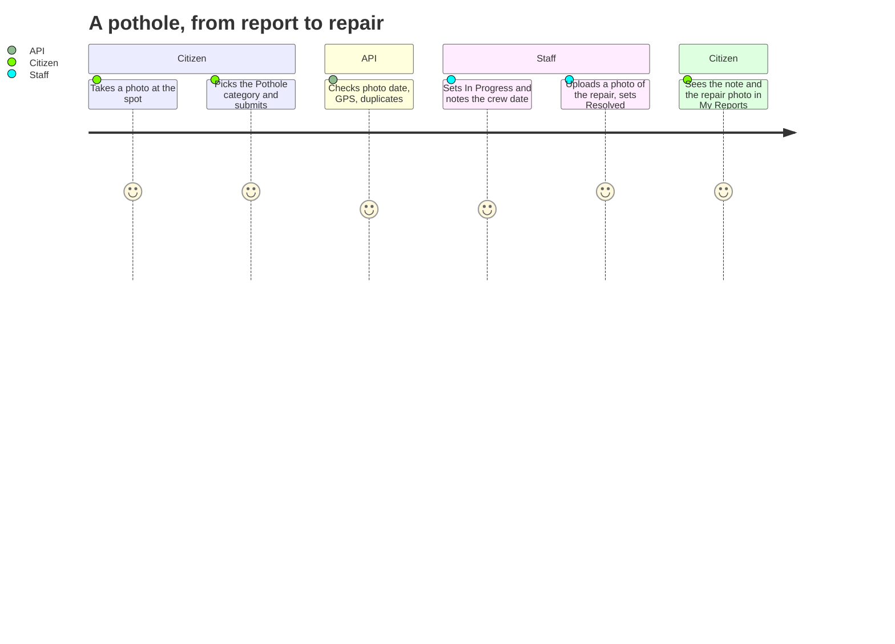

# Product overview

**CivicFix** lets citizens report problems in public infrastructure — potholes, broken streetlights, garbage, drainage — with a photo taken on the spot, and lets municipal staff triage, fix and close those reports in the open.

## Problem

Complaints by phone or paper are hard to verify, easy to lose, and give citizens no visibility into what happens next. Staff cannot tell an old photo from a new one, or whether a report repeats an existing one.

## Solution

| For | CivicFix provides |
|---|---|
| Citizens | A simple Android app: take a photo, pick a category, submit; follow the report's progress and see the resolution photo |
| Staff | One queue of verified, located reports with filters, a review flag for doubtful evidence, and a public timeline to record progress |
| Administrators | Statistics on volumes, backlog and resolution time; control over who has staff access |
| The public | Transparency: every report, status change and staff note is visible |

What makes reports trustworthy: the server checks every photo's embedded date (taken within 24 hours) and GPS position (within 200 m of the reporter), and flags likely duplicates. See [Evidence validation](../architecture/evidence-validation.md).

## Users and roles

| Role | Uses | Can |
|---|---|---|
| Citizen | Android app | Sign up (email, phone or Google); report issues; browse all issues; follow own reports |
| Staff | Admin portal | Everything above, plus see who reported; assign, prioritise and set due dates; change status and category; add notes and resolution photos; view statistics and the map |
| Admin | Admin portal | Everything staff can, plus delete issues; add staff; change roles; reset passwords |

## Features

### Android app (citizens)

| Screen | Features |
|---|---|
| Sign in | Email + password; phone number + SMS code; Google; forgot password; change server address |
| Sign up | Name, email, password |
| Home | All issues, newest first; filter by category; status chips |
| Report | Camera or gallery photo; title, description, category; current location (with map when a Maps key is configured); clear messages when evidence is rejected |
| My Reports | The citizen's own reports with a "Your report" badge |
| Issue detail | Photos (original and resolution), status, address, timeline of status changes and staff notes |
| Profile | Account details; change or set a password; sign out; sign out everywhere |

### Admin portal (staff and admins)

| Page | Features |
|---|---|
| Sign in | Email + password; Google (existing staff only); forgot password |
| Overview | Counts by status, needs review, overdue, assigned to me and unassigned (each links to the filtered list); reported-vs-resolved trend for 7/30/90 days; status chart; categories; open work by priority; workload per person |
| Issues | Table with status, category, priority, assignee, due date, reporter; filters for status, category, assignee (me / unassigned / person), priority, overdue and needs review; search; overdue rows highlighted |
| Map | All issues on OpenStreetMap, coloured by status (urgent ringed in red), filtered by status and category; each dot opens its issue |
| Issue detail | Photo, location map, reporter, timeline; assign (or "Assign to me"), priority and due date (internal); change status and category; add a note for the citizen; upload a resolution photo; delete (admin) |
| Everywhere | Light and dark mode (remembered per browser); works on tablets and phones |
| Staff (admin) | List staff and admins; add with a one-time password; change role; reset password |

## Core journey

## Issue lifecycle

`Open` (new report) → `In Progress` (being handled) → `Resolved` (fixed, ideally with a resolution photo). Staff can move an issue between any of these, for example reopening it. Every change appears in the issue's public timeline.

## Scope

In scope today:

- Android app (APK distributed through GitHub Releases); the code is Expo/React Native, so an iOS build is possible but not set up or tested.
- One municipality per deployment; English interface.
- Categories are fixed in code ([data model](../architecture/data-model.md#issues)).

Not in scope yet (candidates for the roadmap):

- Push or email notifications when a report's status changes
- Departments and SLAs per category (issues can be assigned to people, with due dates)
- Notifications to staff when an issue is assigned to them
- Multiple languages
- Public web page for citizens without the app
- Self-service account deletion and data export

## Non-functional goals

| Quality | Goal |
|---|---|
| Trust | Evidence checked server-side; every staff action recorded |
| Privacy | Reporter identity visible only to staff; minimal personal data ([Privacy](../security/privacy.md)) |
| Availability | 99.5 % monthly for the API on AWS ([Monitoring](../operations/monitoring.md#service-objectives)) |
| Usability | Reporting takes under a minute; rejection messages say how to fix the problem |
| Cost | Runs on a single small database and 1–2 small containers (~USD 50–70/month on AWS) |
| Operability | Deploys, staff management and maintenance from GitHub Actions; no servers to patch |
