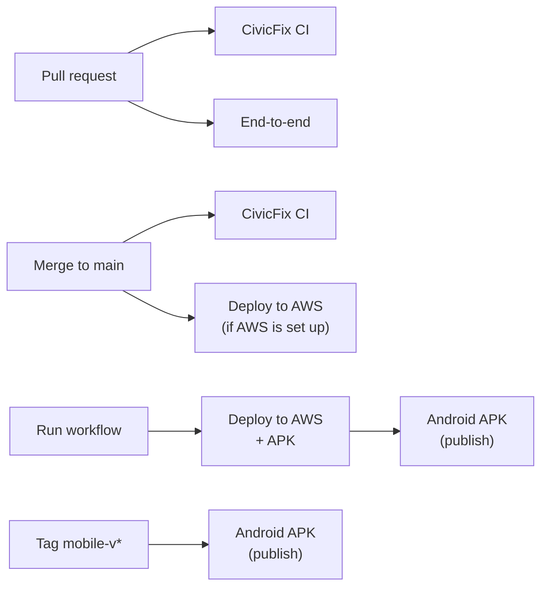

# CI/CD reference

All automation runs on GitHub Actions. Workflows are in [`.github/workflows/`](../../.github/workflows); helper scripts in [`.github/scripts/`](../../.github/scripts).

| Workflow | File | Runs on | Purpose |
|---|---|---|---|
| CivicFix CI | `ci.yml` | Every push to `main` and pull request | Tests, builds and lints every part |
| End-to-end | `e2e.yml` | Every pull request; manually | Real browser and Android emulator tests |
| Deploy to AWS | `deploy-aws.yml` | Push to `main` touching `backend/`, `admin/`, `infra/aws/`; manually | Deploys database, API and admin portal; optionally the APK |
| Android APK | `android-apk.yml` | Manually; tags `mobile-v*`; called by the deploy | Builds, launch-tests and publishes the signed APK |
| AWS admin task | `aws-admin-task.yml` | Manually | One-off scripts inside AWS (create staff, prune photos) |

## CivicFix CI (`ci.yml`)

| Job | Steps |
|---|---|
| `backend` | PostgreSQL 17 service → `npm ci` → `node --check server.js` → `npm test` (unit + integration against `TEST_DATABASE_URL`) |
| `admin` | `npm ci` → `npm run lint` → `npm run build` (with a placeholder `VITE_API_URL`) |
| `mobile` | `npm ci` → `npx expo config --type public` (validates the Expo configuration) |
| `infra` | `cfn-lint` on `infra/aws/*.yml` → `actionlint` on the workflows → `docker build` of the API image → checks the image starts and contains the RDS CA bundle |

## End-to-end (`e2e.yml`)

Both jobs start PostgreSQL and the real API in production mode (`NODE_ENV=production`, short `ACCESS_TOKEN_TTL=30s`, `log` email/SMS providers, a fixed test SMS code), then seed data with `backend/test/e2e/seed.js`.

| Job | What it does |
|---|---|
| `admin-portal` | Builds the portal, runs the Playwright suite in Chromium (`e2e/admin`) |
| `mobile-app` | Builds a debug-signed APK pointed at the API, boots an API 34 emulator and runs the Maestro flows (`e2e/mobile`) via `.github/scripts/mobile-e2e.sh` |

On failure, screenshots, Playwright traces, device logs and the API log are uploaded as artifacts. See [Testing](../testing/strategy.md#end-to-end-tests).

## Deploy to AWS (`deploy-aws.yml`)

Skipped with a notice until the `AWS_DEPLOY_ROLE_ARN` variable exists.

1. **check-setup** — is AWS configured?
2. **test** — backend tests against a throwaway PostgreSQL.
3. **deploy** (signs in to AWS via OIDC):
   1. Finds the default VPC and subnets.
   2. Deploys `infra/aws/base.yml` as `civicfix-base` (RDS, secrets, ECR, S3 + CloudFront, IAM roles).
   3. Builds and pushes the API image to ECR, tagged with the commit SHA.
   4. Deploys `infra/aws/api.yml` as `civicfix-api` (ECS Express Mode service) with that image.
   5. Waits for `/health` to report the database OK, then smoke-tests sign-in and CORS.
   6. Builds the admin portal for the API URL, uploads it to S3 and invalidates CloudFront.
   7. Writes the addresses to the run summary.
4. **android** — only when run by hand with *build_apk*: calls the Android APK workflow with the new API URL and publishes the release.

Runs never overlap (`concurrency: deploy-aws`).

## Android APK (`android-apk.yml`)

| Job | What it does |
|---|---|
| `build` | `expo prebuild` → Gradle `assembleRelease`, signed with the release keystore from secrets (or a debug key, marked as a test build). Server address from the `api_url` input or `MOBILE_API_URL`. Version code = run number |
| `launch-test` | Installs the APK on an emulator and checks it reaches the sign-in screen (`.github/scripts/smoke-test-apk.sh`) |
| `publish` | Creates a GitHub Release *CivicFix Android app (build N)* with `CivicFix-v<version>-build<N>.apk` attached, tagged `mobile-v<version>-build<N>`. Without the signing secrets it publishes only a pre-release marked *TEST BUILD* (debug key) |

Inputs (manual run): `api_url` (without `/api`; empty = the app asks), `publish` (default on).

## AWS admin task (`aws-admin-task.yml`)

Runs a one-off ECS task using the API's current image, network and secrets, so it can reach the private database.

| Task | Effect |
|---|---|
| `create-staff` | Creates or resets a staff/admin account; the password is written to Secrets Manager as `civicfix/staff/<email>`, never to logs |
| `prune-uploads (list only)` | Lists photos no issue references |
| `prune-uploads (delete)` | Deletes them |

## Permissions and security

- Workflows default to `contents: read`; `id-token: write` (AWS OIDC) is granted only to jobs that sign in to AWS, and `contents: write` only to the APK workflow and the deploy job that calls it (to publish releases).
- The AWS role trusts only this repository's `main` branch ([`infra/aws/bootstrap.yml`](../../infra/aws/bootstrap.yml)). Protect `main` (require pull requests and passing checks) because anything merged there can deploy.
- Third-party actions are pinned to major versions; Dependabot proposes updates monthly ([`.github/dependabot.yml`](../../.github/dependabot.yml)).
- Secrets are never echoed; the staff password goes straight to Secrets Manager.

## Recommended branch protection for `main`

Settings → Branches → Add rule for `main`:

- Require a pull request before merging (1 approval if there is more than one maintainer)
- Require status checks: `backend`, `admin`, `mobile`, `infra`, `admin-portal`, `mobile-app`
- Require branches to be up to date before merging
- Do not allow force pushes or deletions
