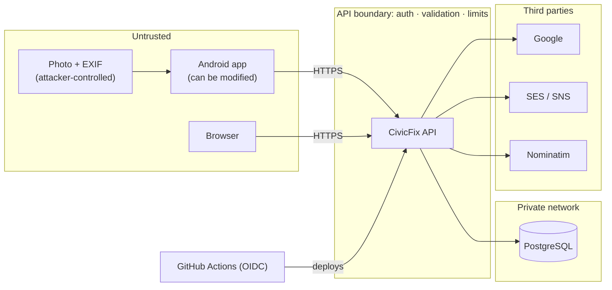

# Threat model

What CivicFix protects, from whom, how, and which risks remain. Review this when adding an endpoint, a data field, an external service or a new kind of user. Controls are described in the [security overview](overview.md).

## Assets

| Asset | Why it matters |
|---|---|
| Accounts and sessions | Taking over a staff/admin account changes or deletes civic records |
| Personal data | Names, emails, phone numbers of citizens and staff |
| Report locations and photos | Reveal where people were; photos may show people, homes, number plates |
| Integrity of reports | Fake or manipulated reports waste crews' time and erode trust |
| Issue status history | Public accountability for what was fixed and when |
| Availability | Citizens must be able to report; staff must be able to triage |
| Infrastructure credentials | Database password, JWT secret, AWS deploy role, Android signing key |

## Actors

| Actor | Capability |
|---|---|
| Anonymous internet user | Calls public endpoints, tries sign-in, scrapes public issues |
| Malicious citizen | Has a valid citizen account; can modify the app and craft requests and photos |
| Compromised staff account | Valid staff session |
| Network attacker | Observes or tampers with traffic on public Wi-Fi |
| Supply-chain attacker | Publishes a malicious npm package or GitHub Action |
| Insider with repository write access | Can change code and workflows |

## Trust boundaries

Everything arriving at the API — headers, bodies, files, EXIF, OAuth redirects, provider responses — is treated as untrusted.

## Threats (STRIDE)

| # | Threat | Category | Mitigation | Residual risk |
|---|---|---|---|---|
| T1 | Password guessing / credential stuffing | Spoofing | bcrypt; lockout after 5 failures; per-IP auth rate limit; generic errors | Lockout can be triggered deliberately against a known email (15-minute denial); limits are per instance |
| T2 | Stolen access token | Spoofing | 15-minute lifetime; session check on every request; HTTPS | Portal tokens are in `localStorage`, readable by any script injected into the portal (no XSS known; React escapes output) |
| T3 | Stolen refresh token | Spoofing | Rotation with reuse detection revokes all sessions; hashed at rest | A thief who uses it *before* the owner does keeps access until the owner's next refresh fails and they sign in again |
| T4 | Guessing email/SMS codes | Spoofing | 6 digits, 5 tries per code, 10–15 min expiry, cooldown, 5 per hour | ~5 × 5 = 25 guesses/hour per target: 1 in 40,000 per hour |
| T5 | SMS pumping (sending many SMS for cost) | DoS / cost | Per-number cooldown and hourly limit; auth rate limit per IP | Many numbers from many IPs; set SNS spend limits and alarms |
| T6 | Forged Google sign-in | Spoofing | ID token signature, issuer, audience, expiry, nonce, verified email; signed `state` | Depends on Google; linking by verified email means whoever controls the Google account for an email controls the CivicFix account with that email |
| T7 | Citizen escalates to staff | Elevation | Role from database; public sign-up only creates citizens; role routes enforced server-side | — |
| T8 | Accessing another citizen's data | Information disclosure | Reporter fields only for staff/admin; `mine` filter uses the session's user | Issue content (description, photo, location) is public by design |
| T9 | Fake report with old or remote photo | Tampering | EXIF date ≤ 24 h, GPS ≤ 200 m, metadata required, duplicate detection, review flag | EXIF can be forged; photos without GPS pass the location check ([evidence limitations](../architecture/evidence-validation.md#known-limitations)) |
| T10 | Malicious file upload | Tampering / Elevation | MIME allow-list, 10 MB, random names, strict serve pattern, `nosniff`, ExifTool timeout | MIME type is client-declared; content is not re-encoded. Images are only served, never executed |
| T11 | Request flooding | DoS | Global and auth rate limits; body limits; ECS scaling | Limits are per instance and per IP; no WAF in front of the API |
| T12 | SQL injection | Tampering | Sequelize parameters; validated inputs | — |
| T13 | Open redirect via Google flow | Spoofing | Redirect targets fixed by configuration (`ADMIN_URL`, `APP_REDIRECT_URI`), not request parameters | — |
| T14 | Secret leakage | Information disclosure | Secrets Manager; `.gitignore`; no secrets in logs | Developers' local `.env` files |
| T15 | Malicious dependency or action | Tampering | Lock files, `npm ci`, Dependabot, actions pinned to major versions | Major-version pins can move; pin to SHAs for stricter control |
| T16 | Malicious change merged to `main` deploys | Elevation | OIDC role limited to `main`; CI and review | Requires branch protection to be enabled by the owner |
| T17 | Database exposure | Information disclosure | Private RDS (no public access), security group limited to the VPC, TLS, encryption at rest | Anything else running in the same VPC can reach the database port; single-AZ; backups in the same account |
| T18 | Loss of Android signing key | Availability | Backed up outside GitHub | If lost, every citizen must uninstall before updating |
| T19 | Personal data in logs | Information disclosure | No passwords, tokens or codes logged | Evidence processing logs coordinates and EXIF summaries; logs kept 30 days |
| T20 | Repudiation of staff actions | Repudiation | Every status change and note recorded in `issue_updates` with author | Admin account management (role changes, resets) is not yet written to an audit table |

## Prioritised improvements

1. **Enable branch protection on `main`** (T16) — configuration only.
2. **Audit log for account management** (T20): record role changes, password resets and staff creation.
3. **Reduce evidence logging** (T19): log decisions, not coordinates/EXIF.
4. **Flag GPS-less photos for review** (T9).
5. **HttpOnly cookie sessions for the portal** (T2), with CSRF protection.
6. **Shared rate-limit store and a WAF** (AWS WAF on the API endpoint) before heavy public use (T1, T5, T11).
7. **Re-encode uploaded images** (strip metadata, normalise format) after validation (T10, privacy).
8. **Pin GitHub Actions to commit SHAs** (T15).
