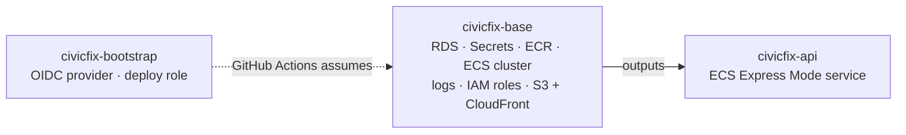

# AWS infrastructure (CloudFormation)

Three templates. You create **`bootstrap.yml`** once by hand; the other two are deployed by [`.github/workflows/deploy-aws.yml`](../../.github/workflows/deploy-aws.yml) on every deploy. Step-by-step setup: [Deploy on AWS](../../docs/deployment/aws.md).

| Template | Stack name | Created by | Contains |
|---|---|---|---|
| [`bootstrap.yml`](bootstrap.yml) | `civicfix-bootstrap` | You, once (console) | GitHub OIDC identity provider (optional) and the `DeployRoleArn` role GitHub Actions assumes, limited to one repository and branch |
| [`base.yml`](base.yml) | `civicfix-base` | Deploy workflow | Database, secrets, container registry, ECS cluster, logs, IAM roles, admin portal hosting |
| [`api.yml`](api.yml) | `civicfix-api` | Deploy workflow | The API service (ECS Express Mode) |

## `base.yml` resources

| Resource | Type | Notes |
|---|---|---|
| `ImageRepository` | ECR repository | API images; keeps the last 20 |
| `JwtSecret` | Secrets Manager `civicfix/jwt-secret` | 64 random characters |
| `DbSecret` | Secrets Manager `civicfix/database` | Username `civicfix`, 32-character password |
| `DbSecurityGroup`, `DbSubnetGroup` | EC2 / RDS | PostgreSQL port open only inside the VPC CIDR |
| `Database` | RDS PostgreSQL 17 `civicfix-db` | gp3, encrypted, private, deletion protection, automated backups, snapshot on delete/replace, auto minor upgrades |
| `Cluster` | ECS cluster `civicfix` | |
| `ApiLogGroup` | CloudWatch `/civicfix/api` | 30-day retention |
| `ExecutionRole` | IAM `civicfix-ecs-execution` | Pull images, write logs, read the CivicFix secrets |
| `TaskRole` | IAM `civicfix-ecs-task` | What the API itself may call: `ses:SendEmail`, `sns:Publish` |
| `InfrastructureRole` | IAM `civicfix-ecs-infrastructure` | Lets ECS Express Mode manage the load balancer and networking |
| `AdminBucket`, `AdminOriginAccessControl`, `AdminDistribution`, `AdminBucketPolicy` | S3 + CloudFront | Private bucket served only through CloudFront (HTTPS), SPA fallback to `index.html` |

Parameters: `VpcId`, `VpcCidr`, `SubnetIds` (the default VPC, found by the workflow), `DbInstanceClass` (default `db.t4g.micro`), `DbAllocatedStorage` / `DbMaxAllocatedStorage`, `DbBackupRetentionDays` (default 7).

Outputs consumed by the workflow and `api.yml`: `ImageRepositoryUri`, `ClusterName`, `ExecutionRoleArn`, `InfrastructureRoleArn`, `TaskRoleArn`, `ApiLogGroupName`, `JwtSecretArn`, `DbSecretArn`, `DbHost`, `DbPort`, `AdminBucketName`, `AdminDistributionId`, `AdminUrl`.

## `api.yml`

One `AWS::ECS::ExpressGatewayService` (`civicfix-api`): Fargate tasks (default 0.5 vCPU / 1 GB, 1–2 tasks) behind an HTTPS endpoint `https://….ecs.<region>.on.aws`, health check `/health`. The container gets its configuration as environment variables and its secrets (`JWT_SECRET`, `DB_USER`, `DB_PASSWORD`, optional `GOOGLE_CLIENT_SECRET`) from Secrets Manager. Optional parameters switch on email (`EmailFrom`), SMS (`EnableSms`, `SmsSenderId`, `SmsEntityId`, `SmsTemplateId`) and Google sign-in (`GoogleClientId`, `GoogleClientSecretArn`); they come from repository variables ([Configuration](../../docs/reference/configuration.md#repository-variables)).

## Changing the templates

- Open a pull request; CI runs `cfn-lint` on all three templates.
- Prefer changes that update resources in place. Check *Update requires: Replacement* in the CloudFormation docs before changing a database or bucket property — the database is protected by a snapshot policy, but a replacement still means a new, empty instance restored from that snapshot by hand.
- Never put secret values in parameters or outputs; reference Secrets Manager.
- Keep IAM names under the `civicfix-` prefix: the deploy role may only manage roles with that prefix.

## Cost

Roughly USD 50–70 a month at low traffic (load balancer, one Fargate task, `db.t4g.micro`, public IPv4 addresses, CloudFront and logs). Use the [AWS Pricing Calculator](https://calculator.aws/) for your region and set a budget alert.
